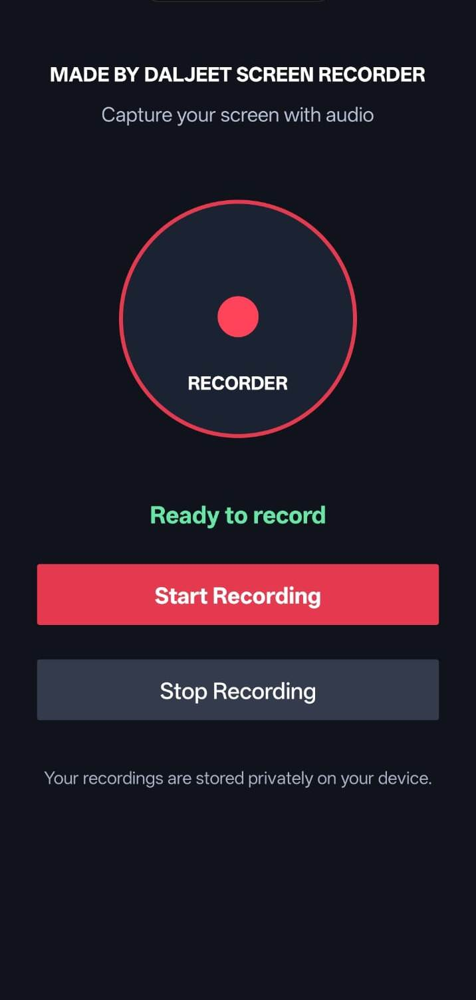
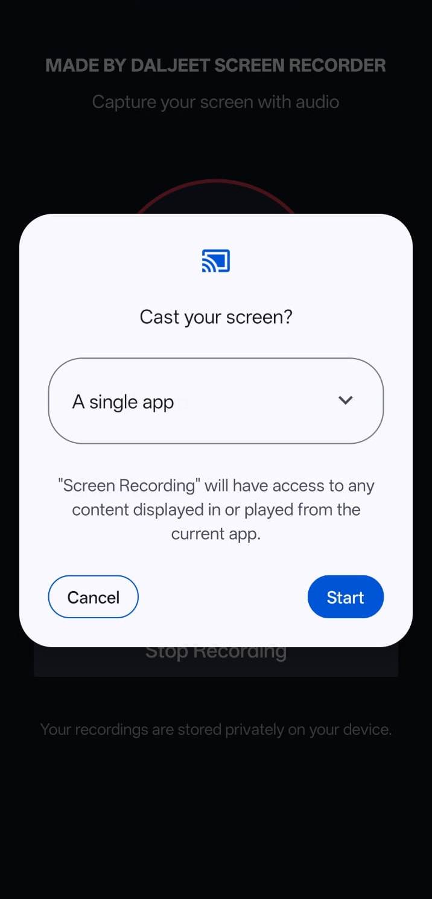

# \# 📱 Android Screen Recording App

# 

# \## 💰 Project Price: ₹299 INR

# 

# An Android screen recording application built with \*\*Java and XML\*\*. It uses Android's MediaProjection API to capture the screen with user permission and provides recording controls, status updates, and video saving.

# 

# \## 🎥 Watch the App Demo

# 

# ▶️ \[Watch the Screen Recording App Demo on YouTube](https://www.youtube.com/shorts/sY_3kBTPIec)

# 

# \## 📥 Download the APK

# 

# 📱 \[Download the Android APK](https://drive.google.com/file/d/1iR_4siiB4crBsTMckNxmAGNY_blzU4CR/view?usp=sharing)

# 

# \## 📸 App Screenshots

# 

# \### 🏠 Home Screen






# \## ✨ Features

# 

# \- Start and stop screen recordings.

# \- Capture the screen using Android's MediaProjection API.

# \- Simple and user-friendly interface.

# \- Recording status updates and controls.

# \- Save recorded videos for playback.

# \- Foreground service support for screen recording.

# \- Microphone audio capture where supported and permitted.

# 

# \## 🛠️ Technologies Used

# 

# \- \*\*Language:\*\* Java

# \- \*\*UI:\*\* XML

# \- \*\*Platform:\*\* Android

# \- \*\*IDE:\*\* Android Studio

# \- \*\*Screen Capture:\*\* MediaProjection API

# \- \*\*Video Recording:\*\* MediaRecorder

# \- \*\*Version Control:\*\* Git and GitHub

# 

# \## 📋 Requirements

# 

# \- Android Studio

# \- Android SDK compatible with the project

# \- Compatible Android device or emulator

# \- User permission for screen capture

# \- Microphone permission if audio recording is enabled

# 

# \## 🚀 How to Run the Project

# 

# 1\. Clone the repository:

# 

# &#x20;  ```bash

# &#x20;  git clone https://github.com/daljeetdeveloper/ScreenRecordingApp.git

# &#x20;  ```

# 

# 2\. Open the project in Android Studio.

# 3\. Allow Gradle to sync and install required SDK components.

# 4\. Connect an Android device or start a compatible emulator.

# 5\. Build and run the application.

# 6\. Grant the requested permissions.

# 7\. Use the Start and Stop controls to test recording.

# 

# \## 🔒 Privacy and Recording Limitations

# 

# Screen recording requires the user's permission. Apps that use DRM or Android secure-display features may show a black screen in recordings. This project does not bypass DRM or secure-video restrictions.

# 

# \## 👨‍💻 Developer

# 

# \*\*Daljeet Kumar Singh\*\*

# 

# \- \*\*GitHub:\*\* \[daljeetdeveloper](https://github.com/daljeetdeveloper)

# \- \*\*Portfolio:\*\* \[daljeetkumarsingh.com/portfolio](https://daljeetkumarsingh.com/portfolio/)

# 

# \## 📄 License

# 

# Check the repository's license before reusing, modifying, or distributing this project.

# 

# \## 🤝 Feedback and Contributions

# 

# Suggestions, bug reports, and improvements are welcome. Please open a GitHub Issue to report a problem or suggest an enhancement.

# 

# \---

# 

# ⭐ If you find this project useful, consider starring the repository!

